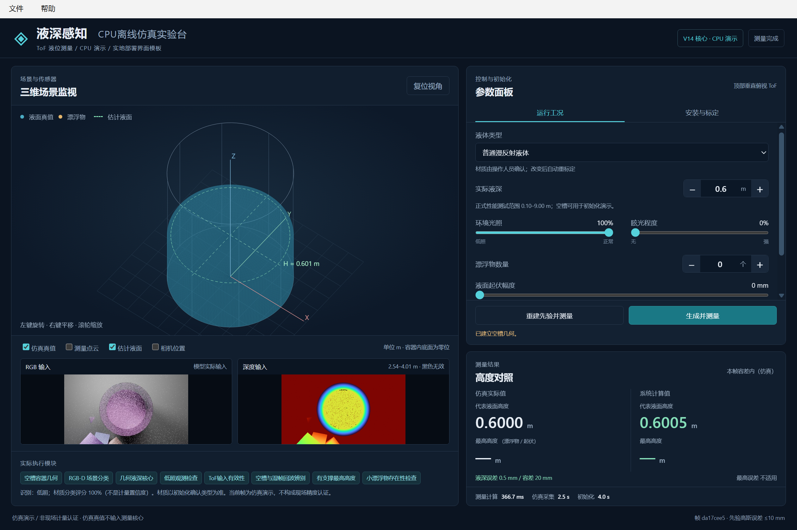

# ToF RGB-D 液深测量系统

## `simulation-desktop`：CPU 独立仿真桌面软件

本分支用于 Windows x64 的离线仿真桌面入口与打包源码。沿用 V14 正式测量核心，增加本地资源加载、CPU 执行、桌面窗口与安装参数接口；**没有用桌面 CPU 演示替换 `main` 正式链路，也没有用下面的小规模检查替换正式性能报告**。下文保留主线及历史研究说明，CPU 分支的启动方法和限制以本节为准。

2026-10-21：最终 EXE 已从桌面中文路径、仅系统 PATH 环境完成 **12个场景用例、5个标定切换、2个故障拒绝、18项真实桌面界面检查**。常规复用标定操作中位约3.06秒。[去路径化验收数据](reports/evidence/desktop-cpu-v1.0.0/acceptance.json)及[验收说明](docs/desktop_acceptance.rst)随分支保存；这是CPU便携功能验证，不替代下文GPU统计报告。此分支存放源码、模型、构建配方与证据；完整Windows二进制包已交付本地桌面，不将约2.9GB运行库提交到Git历史。



完整便携包的入口为 `LiquidDepthSimulation.exe`。使用发布目录时不需要另外安装 Python、CUDA、Blender 或浏览器，不需要 SSH、联网或 USB 相机。Qt WebEngine 在独立桌面窗口内显示界面，本机回环通信仅供软件内部使用。

**必须完整解压并保留整个 `LiquidDepthSimulation` 目录，不能只复制 EXE。** 内置模型、运行库、仿真器、脚本及第三方许可文件都是运行资源。可以在桌面建立主程序快捷方式；源码仓库不等于已生成的便携二进制包，不在此承诺尚未发布的下载链接。

### 能做什么

- 启动时自动生成默认空槽与独立标定先验，随后完成首帧测量；安装、材质、光学参数或标定模式变化时自动重标定。
- 调整圆柱、椭圆柱、矩形容器的完整内尺寸与高度，调整顶部相机到底面距离、偏心和自动构图。
- 调整液深、低照、眩光、起伏、漂浮物、0%–50% 深度缺失；透明类另有折射率、回波权重及半透明散射设置，物性不直接交给测量逆解。
- 旋转、平移、缩放三维场景，查看 RGB / 深度输入、真值与估计值、实际执行模块；分别显示初始化、仿真采集和测量计算耗时。
- 不合格输入在测量前跳过；完整记录保存在 `%LOCALAPPDATA%\LiquidDepthSimulation`，可从桌面“文件”菜单导出当前测量 JSON 或打开日志目录。

### CPU 演示的性能与范围边界

CPU 入口使用 **Blender Cycles CPU**，不是正式服务器报告中的 EEVEE。当前在 **Intel Core Ultra 9 285K（24 核）** 上的 12 个功能冒烟用例观察到：测量计算约 **34–774 ms**，仿真采集约 **2–2.6 s**，复用标定总耗时约 **3 s**，含重标定约 **5–7 s**。首次加载、处理器和系统负载会影响耗时，普通低配电脑可能明显更慢；这些数字不是完整性能认证或最大时延承诺，部分测量已超过 0.5 s。

即使测量代码及权重来源相同，Cycles CPU 的 RGB 光照与材质呈现仍可能不同，**不能直接套用下文 EEVEE / GPU 测试的通过率、误差和延时**。源码冒烟测试也不能代替最终 EXE 的资源闭包与 Qt 窗口验收，状态见[桌面验收边界与记录](docs/desktop_acceptance.rst)。

正式报告液深范围为 **0.10–9 m**；空槽及低于 0.10 m 仅作诊断。相机保持顶部俯视、到底面不超过 10 m；实际发布测试的相机距离约 3.532–9.999 m，不是所有可输入安装都已测试。透明/半透明限均匀、平整、无遮挡液体，不开放漂浮物或起伏组合；透明类与照明/缺失联合设置属探索配置。输入超出已发布采样边界时会提示，不沿用既有通过率。当前不含真实相机 SDK、泵阀 / PLC 或安全联锁，不是工业真机计量认证软件。

- [CPU 离线版中文使用说明](docs/CPU_DESKTOP_GUIDE.rst)
- [浅色离线 HTML 使用说明](docs/cpu_desktop_help.html)（下载后可本地查看，无外部资源）
- [操作面板与接口说明](docs/desktop_ui.rst)

### 从源码运行与打包（开发机）

下列命令在仓库根目录的 PowerShell 中执行。**只有构建开发机**需要 Windows x64 Python、已安装的项目运行依赖、CPU 版 PyTorch / torchvision、SciPy、scikit-learn **1.9.0**、joblib、Pillow、PySide6 和 PyInstaller，以及 MSVC x64 或 MinGW-w64 编译器。需准备完整、可信的 Windows Blender **4.2.0** 目录；不能只提供 `blender.exe`。

```powershell
# 换成开发环境和完整 Blender 目录的实际路径。
$desktopPython = "C:\path\to\python.exe"
$desktopBlender = "C:\path\to\blender-4.2.0-windows-x64"

# 生成正式森林的 Windows 原生库及哈希清单；不改变数值算法。
& $desktopPython scripts/build_native_forest.py

# 源码桌面入口；默认 CPU 推理、Cycles CPU 采集和自动初始化。
& $desktopPython scripts/desktop_launcher.py --blender (Join-Path $desktopBlender "blender.exe")

# 独立的首场景功能检查；不是正式性能评估。
& $desktopPython scripts/desktop_launcher.py --self-test --quick `
  --blender (Join-Path $desktopBlender "blender.exe") `
  --output output/desktop-quick-check.json

# 真实 Qt 窗口验收：初始化、图像/Canvas、数值回显、切页截图；结束后自动退出。
& $desktopPython scripts/desktop_launcher.py --gui-self-test `
  --blender (Join-Path $desktopBlender "blender.exe") `
  --work output/desktop-gui-check --output output/desktop-gui-check.json

# 构建完整便携目录；该命令会再次构建原生库并运行 PyInstaller。
.\scripts\build_desktop.ps1 -Python $desktopPython -BlenderDirectory $desktopBlender
```

预期构建入口是 `dist/LiquidDepthSimulation/LiquidDepthSimulation.exe`；交付时复制整个同名目录。构建脚本为 [build_desktop.ps1](scripts/build_desktop.ps1)，资源清单见 [liquid_simulation.spec](packaging/liquid_simulation.spec)。打包过程成功不代表所有功能已经验收，仍需按验收矩阵检查离线启动、搬移目录、容器及复合工况、真实计时、资源完整性和退出行为。

## 服务器支持的单文件 HTML 入口

已增加 `液深仿真_服务器版.html`：复制这一个文件到另一台电脑，双击后自动进入服务器仿真界面，无需安装运行库、GPU 环境或 SSH 客户端。Blender 渲染、初始化、分类及测量在服务器执行，浏览器显示三维画面并发送控件操作。入口先检查连接并自动重试；各浏览器有独立的容器与标定状态，计算在服务器串行执行。

本次真实浏览器完成7项工况/操作与12项功能检查，包括独立浏览器、液深调整、容器/相机变更、复合工况以及透明和半透明。另验证了首次连接失败后的自动恢复。验证属于部署功能检查，[证据与截图](reports/evidence/server-html-v1-20261021/browser.json)随本分支保存。

当前使用临时 HTTPS 隧道，需要服务器与服务保持运行；重建隧道会更新地址和生成的入口文件。私人入口保存在服务器 `private/liquid_remote.html` 并交付桌面；仓库保存其生成模板和部署代码。[使用与部署说明](docs/REMOTE_HTML_GUIDE.rst)。

---

<!-- V14_CURRENT_PERFORMANCE_START -->
## 当前正式链路评估：0.1–9 m液深、固定±10 mm标定误差（2026-10-21）

当前PDF已精简为10页：保留场景总表、程度分层、复合场景、最高高度、误差区间与延时结果；数据集构建仅作简述，不附部署说明或验证记录。数值仅来自服务器正式测试，未混入CPU桌面软件测试；原始统计数据不变。

[正式V14全场景性能报告](reports/2026-10-21_tof_v14_range01-9_fixed10mm_performance.pdf)冻结当前正式算法，以 1400 帧单场景、1100 帧复合场景测试。8类单场景、14个程度小类与11种复合组合分别统计，每小类100个合格输入。每类实际液深按0.1–1 m取12帧，其余1 m分带各11帧，覆盖至9 m。相机到底面设计范围沿用0.9–10 m。圆柱/椭圆/矩形容器、尺寸、顶部偏心安装及回波噪声变化；同安装多帧相关，不能把帧数当独立安装数。

主体使用用户指定的固定标定误差预算：所有米制标定量采用零均值截断高斯，截断前σ=10/3 mm，绝对误差限制±10 mm；拒绝重抽越界误差，不裁剪测量输出。空槽标签0由底面基准承载不确定度；四张非零液深先验也加入扰动。像素点击σ=0.3 px、重力分量σ=0.001不变。理想标定仅作同图对照，不是验收要求。

复用符合范围与预先配额的旧输入872张，新采1628张；两种标定下全部5000次测量重新运行，旧测量数值不复用。不能仅因旧标定误差恰好小于10 mm便把旧距离比例高斯当作新分布。旧域外与配额外输入退出当前统计，原始实验保留归档，不作为资格失败。正式测试入口见[协议与运行说明](scripts/evaluate_range10mm/PROTOCOL.rst)。

主体液深MAE 3.484 mm，液深通过率 100.00%，功能通过率 99.80%，液深数值覆盖率 100.00%。稳态测量P95 357.4 ms，超过500 ms共0帧。完整分母、误差分布、配对差异、排除原因和参数实际覆盖见[统计证据](reports/evidence/formal-v15-range01-9-fixed10mm-20261021/performance.json)。

本批实际液深为 0.1019-9.0000 m，相机到底面实际范围 3.532-9.999 m。分带均衡不构成连续量程逐点或真实工业应用认证。功能通过率对波面或漂浮物要求液深及最高高度均合格；透明/半透明相位分支不要求最高高度输出。

资格在测量前按模拟可见性/回波来源判断，不按估计误差筛帧；合格大误差和无输出保留。透明/半透明限均匀平整无遮挡液体、三频四相数据和5帧先验，其解析相位模型并非完整光谱渲染。RGB低照和ToF失效不再硬绑定；新增噪声为参数化敏感性包络，不冒充实测相机精度。旧窄域理想标定与历史V1/双相机结果保留作开发证据，不直接解释为算法增益。此报告不是工业真机认证。
<!-- V14_CURRENT_PERFORMANCE_END -->

当前正式统一版：`formal_tof_v14_20261021`（公开深度入口：`tof_formal_v14_dynamic_wet_interior_20261021`）。只适配ToF，默认采用当前三维容器内部与空槽/湿帧回波身份修复，并接入已验证的视觉辅助选路。透明/半透明原相位链路不变；标签组合完全正确不再是硬性验收要求，以数值误差、功能通过率、覆盖率和时延联合评估。正式软件版本不等于现场计量认证。详见[正式V14链路与启动说明](docs/formal_tof_v14.rst)。

### 历史：小漂浮物最高高度增强（2026-10-20）

新增训练1280帧、验证320帧、独立测试1000帧（按安装隔离）。合格漂浮物486帧的最高高度MAE为22.0→19.3mm，通过率92.18%→94.24%，最高容差为`max(50mm,5%真实最高高度)`。全部1000帧液深逐帧不变；最大误差1.381m仍未消除，不隐去严重退化帧。

自动统一入口补充最高高度专用存在性探测，以弥补场景分类漏启用；手工入口仍仅在`floating_objects`且视觉开启时执行。新候选只与最高高度合并，不能干预液深或透明相位。
无漂浮物对照仍有视觉误报，虽未新增容差失败，不能用作安全联锁。已支持因素组合不等于任意复合场景全覆盖。

```bash
pip install -e '.[tof-vision]'
```

启动时调用`warm_optional_peak_models()`，模型加载/预热单独报告，不计入暖态单帧延时；不是硬实时保证。
`UnifiedToFMeter(..., small_float_peak=False)`可回放formal v2最高高度；`ToFSceneMeter.from_empty_geometry`提供同名选项。`compound_repair=False`是更旧几何路径，不能与此混淆。
原始证据、误差分布、失效诊断与直接串联延时见 [独立测试证据](reports/evidence/small-float-v3-20261020/summary.json)。

### 历史：2026-10-20视觉选路研究（当时未替换正式头）

新选路候选经过三轮研究；最新6248开发帧、320验证帧、独立100安装/1600测试帧。预先选定候选的四开关完整组合正确率88.56%，单开关平均97.00%；漂浮物精确率92.81%、召回率88.17%。均与同帧原头比较，不把物理初始化算作视觉分类成功。
严格90%组合/漂浮物召回门槛未通过，因此**未覆盖正式分类权重或选路流程**。同最终集的已冻结V2候选达89.69%组合，但也未过漂浮物召回门槛，不据测试集倒选正式版。
分类延时不等于整链延时，透明材质判断也没有因此获得90%保证。见 [三轮研究与不足](docs/MODULE_ROUTER_RESEARCH_20261020.rst) 和 [研究证据](reports/evidence/module-router-v5-research-20261020/research-summary.json)。

本项目是固定机位、限定物理假设的仿真与软件接口版本，**不是任意真实相机、USB驱动、工业GUI或工业计量验收均已完成的产品**。

## 模块化统一入口与仿真展示（实验版，2026-10-19）

新增 `UnifiedToFMeter` 与统一 `ToFObservation` / `ToFInstallation`，整合既有数值算法；
RGB-D 多标签分类头提出场景建议，独立物理先验决定透明链路是否可用。
液深只使用一个核心；可选视觉仍仅影响漂浮物最高高度。
自动选路仍不等于工业计量认证；人工场景入口保留，默认液深数值内核为正式 v2，小漂浮物最高高度为 v3，相位数值算法不变。

```bash
LIQUID_PYTHON=/root/autodl-tmp/envs/liquid-depth/bin/python bash scripts/launch_scene_console.sh
# 本机另开终端，建立回环隧道后访问 http://127.0.0.1:18765
ssh -N -L 127.0.0.1:18765:127.0.0.1:8765 -p 26663 root@connect.bjb2.seetacloud.com
```

展示可旋转三维液面/容器、查看测量点云、调节液位、光照、眩光、漂浮物、起伏和缺失比例，
对照真值与估计值。空槽与五帧先验在仿真初始化中自动建立，当前真值不传给测量模块。
需要已配置的 Blender 与项目研究环境。没有连接 USB 相机，不控制真实泵阀。

- [使用流程、模块边界与组合限制](docs/UNIFIED_TOF_CONSOLE.rst)
- [分类与组合实验记录](reports/evidence/unified-console-v1-20261019/summary.json)

独立 288 图分类试验不等于液深计量认证；材质混淆、分类误报以及组合工况的高度长尾尚未解决。
透明+漂浮物/起伏、多层、强散射和大于50%液面缺失不纳入展示支持范围。
原正式性能 PDF 不由这些初步自动选路结果替换。

### 复合场景证据修复（可选，2026-10-20）

修正演示仿真器的无命中背景噪声和眩光误触发多层退化；新增独立的输入有效性、
空槽/湿表面证据竞争与有支撑最高高度模块。用户确认后，数值修复已设为正式 v2 默认；旧源码与报告封存：

```bash
LIQUID_PYTHON=/root/autodl-tmp/envs/liquid-depth/bin/python \
  bash scripts/launch_scene_console.sh --port 8766 --compound-repair
```

新独立测试为 100 安装×16 条件，旧新算法使用同一套修正后输入；
不能把仿真输入纠错冒充算法增益。部分输入审计/0–50%缺失合格子类不足100，
仍属研究验证，透明相位链路不启用本模块。
详见 [可选模块与边界](docs/COMPOUND_TOF_REPAIR.rst)。

## 版本证据与历史报告

- [ToF v1 历史正式性能报告](reports/2026-10-17_tof_performance.pdf)：5744帧，保留原始统计，不冒充 v2 新评估。
- [ToF v2 独立对照证据](reports/evidence/compound-repair-v2-20261020/summary.json)：100安装×16条件；新旧使用同一修正后输入，包含误差分布、通过率、P95、最大误差与分母。
- [ToF 正式计算链路](reports/2026-10-17_tof_formal_pipeline.pdf)：封面、目录、八类场景结构示意图、模块注释、标定与输入契约。
- [历史双相机性能报告](reports/2026-10-17_dual_camera_performance.pdf)：**原文件原样保留**，记录比较后选择ToF的开发依据；不是当前支持范围。原实现见Git提交 `15bfe99`。
- [更早开发进展](reports/2026-10-16_development_history.pdf) 与 [历史全场景报告](reports/2026-10-16_system_and_scenario_evaluation.pdf) 是历史记录，不是当前验收报告。

远距浅液位专题报告已从当前目录删除，其原始帧仍全部进入ToF统计，不通过删除困难帧提高成绩。

## 场景及应用边界

| 场景 | 输入与标定 | 当前计算 |
|---|---|---|
| 普通漫反射 | 空槽RGB-D、内参、轮廓、独立米制锚点 | 冻结对称候选几何 |
| 部分深度失效 | 同上，液面数值空洞0%-50% | 同一液深几何；不加置信拒绝门槛 |
| 低照 / 眩光 | 同上 | 不自动以RGB增强替代液深 |
| 不平整液面 | 同上 | 代表液深与V11最高包络 |
| 漂浮物 | 同上，可选RGB | 液深不变，视觉仅最高高度；V8/V5基线加小漂浮物可靠候选 |
| 均匀透明 / 轻半透明 | 1空槽+4已知液深原始相位组，独立几何标定 | AMCW iToF光程与混合回波逆解 |

透明链路需要**三频四相原始相关图**，本轮20/30/50MHz；只导出深度图的SDK不能直接启用。脉冲dToF不等于已经支持该相位路线。底部调制须可见、液体性质和机位须稳定；不承诺多层、强散射、持续移动或超过50%深度失效。

仿真消光不是850/940nm实测水光谱，不证明近红外能穿透9m水层；真实部署须核查吸收、散射、信号预算、多径和温漂。

## 性能口径

从冻结的11390帧比较测试中保留**全部5744帧ToF**，预测与真值不变。未重新训练、未重新挑样，也未声称新的独立测试提升。保留原来源与安装聚类；每个报告小类不少于100帧。

液深容差 `max(20mm,2%真实H)`；不平整代表高度和所有最高高度为 `max(50mm,5%真实高度)`。空槽不算相对误差，仍计绝对误差及通过率；数值覆盖率不是准确率。

注意：v1 历史报告保留约3.43m孤立异常；v2 对该帧的单独回放已改善，但不冒充完整旧数据重验。液深稳定不等于最高高度安全可靠。算法延时不含完整采集，仍不保证每帧低于0.5s。

## 运行

```bash
git clone --recurse-submodules https://github.com/ZhuShanzhe/Liquid-Surface-Detector-based-on-CV.git
cd Liquid-Surface-Detector-based-on-CV
python -m pip install -e '.[dev,train,research]'
python -m pip install scikit-learn==1.9.0 joblib==1.5.3
PYTHONPATH=src:scripts python -m pytest -q

PYTHONPATH=src:scripts python scripts/measure_tof.py \
  --scene ordinary_diffuse --initialization /path/tof_init.json --depth /path/current.npy

PYTHONPATH=src:scripts python scripts/measure_tof.py \
  --scene homogeneous_transparent --initialization /path/tof_phase_init.json \
  --phase-capture /path/current.npz

python scripts/recount_tof.py
```

初始化JSON的 `sensor_family` 必须为 `tof`，与bundle一致。普通 `kind=empty_geometry`，含 `bundle`、`dry_depth`；透明 `kind=five_phase_priors`，还含 `scene`、`profile`、`rays_roi`、五个 `prior_captures`、五个 `known_heights_m`（0及四个容量内递增非零高度）。NPZ含 `correlations[3,4,H,W]`。

漂浮物最高高度可加 `--rgb` 与 `--enable-floating-peak-vision`，其他场景不调用该视觉模块。长期运行常驻一个 `ToFSceneMeter`，不要每帧重新标定。服务器验证环境：Python3.11、PyTorch2.11.0+cu128、NumPy2.4.6、SciPy1.17.1、OpenCV4.14.0。

## 代码与复现

- `configs/application_route.json` / `tof_scene_routes.json`：唯一当前入口及场景契约。
- `src/liquid_depth/tof_scene_meter.py` / `tof_phase_refraction.py`：ToF门面及专用相位逆解，不含投影相位逆解。
- `scripts/measure_tof.py`：非ToF初始化直接报错，不隐式回退。
- `generate_tof_far.py` / `evaluate_tof_far.py`：ToF几何采样及输入审核。
- `tof_phase_simulator.py` / `evaluate_tof_phase.py`：ToF原始相位仿真，前向24层、逆向4层散射积分。
- `publish_tof_evidence.py` / `recount_tof.py` / `verify_tof_release.py`：证据导出、独立复算与观察回放。
- `build_tof_reports.py`：两份正式PDF，需ReportLab及中文字体；`PDF_CN_FONT`、`PDF_CN_BOLD_FONT`可指定字体。
- `reports/evidence/tof-formal-v1-20261017/`：当前预测、指标、验证、哈希。
- `reports/evidence/dual-camera-v2-20261017/`：仅为历史比较报告审计，不是当前相机入口；源码锁对应提交 `15bfe99`。

共享冻结几何源码与更早研究模块保留历史兼容实现以免破坏ToF依赖，**研究脚本不是支持的生产入口**。当前双相机门面、专用投影相位实现、配置及采样入口已撤销，后续不维护另一类相机链路。

服务器原观察位于 `/root/autodl-tmp/liquid-depth-data/synthetic/dual-camera-v2-20261017/`；原目录名保留用于来源核对，不伪造重新采集。切换备份及验证：`/root/autodl-tmp/liquid-depth-artifacts/tof-release-20261017/`。大数据、环境、密码不上传Git；可选小模型在 `assets/models/v8`，仅加载可信文件。

## 可变安装与自动构图展示（2026-10-20）

浏览器控制台现支持容器内高度、相机到底面距离和顶部垂直俯视。
默认自动构图在虚拟水平视场54°–100°内完整看见槽口并保留12%边距；必要时上移相机，
实际距离回填显示，最大10m。安装参数或材质改变后自动重新采集空槽、重建几何和五帧相位先验，
而不是只改变网页缩放。超出物理/应用边界时明确报错，不归零或裁剪测量值。

完整流程、额外已知尺寸的使用边界及实验启动方式见 [自动构图说明](docs/console_auto_framing.rst)。
本次参数网格与复合工况测试属于软件回归，不替代原正式大样本性能报告或现场计量认证。
历史阶段曾暂缓桌面打包；本 `simulation-desktop` 分支现另行维护文首的 CPU 桌面入口，不能把其功能检查与原性能报告混为一谈。当前入口已采用V14正式工厂及对应仓库内模块，不再依赖V10/V13实验目录执行。以下V5构图与前置资格规则继续保留；数值版本以V14说明和新报告为准。

V5展示在算法前增加仿真输入资格检查：不满足可见性/0%–50%液面缺失等范围的帧不执行分类和测量，
不输出估计值，也不计入性能统计；只记录跳过原因。该仿真适配层使用独立可见性标签，
不将标签送入模型，也不能冒充实地可用的可观测性判断。详见同一份自动构图说明。

## 正式V14强复合补测（2026-10-21）

11种复合组合每种至少100个合格帧，共1103帧。功能通过率100.00%，液深MAE 1.86mm、最高高度MAE 4.83mm；计算延时P95 461.0ms、最大575.1ms。数值覆盖率以合格输入为分母，输入跳过数量、尾部误差及分组合结果单列，不能解释成现场全输入均可测。

[逐组合性能与误差分布](reports/正式ToF_V14_强复合场景性能报告_2026-10-21.rst) · [机器可读证据](reports/evidence/formal-v14-20261021/performance.json)。新复合集不用于调参；标签不同但数值合格照常计为功能合格。
复现已标定数据：`PYTHONPATH=src:scripts python scripts/replay_formal_tof.py --dataset /path/to/test-root --output /path/to/new-results`。需要服务器数据归档中的replay-manifest.json、空槽标定及采集帧，不下载原始数据也可直接查看汇总证据。
