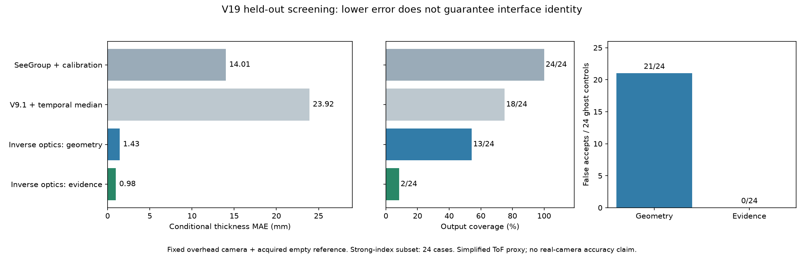
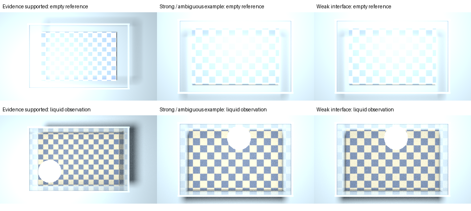

# V19：固定顶部相机的折射建模优化

## 结论

**已实现一条不依赖 SeeGroup 权重的多层液体研究链路。折射几何估计明显优于本轮冻结神经网络基线，但可靠区分真实界面与错误回波的覆盖率仍低，尚不能替换为工业测量方案。**

在 24 个独立配置的强折射率差异测试条件中：

- 几何原型：13/24 通过几何门限，层厚 MAE **1.43 mm**，P95 **3.44 mm**。
- 默认的折射证据检查：2/24 通过，层厚 MAE **0.98 mm**。只有两例，不能据此宣称总体毫米级精度。
- 24 个独立稳定伪回波压力测试中：几何原型误收 **21/24**，增加单层介质竞争解释和底纹色度约束后误收 **0/24**。
- 弱折射率差异测试：0/24 获得支持充分的内部界面输出，仍未解决。

因此，**多层研究主线转向新物理模型；SeeGroup 保留作冻结对照，不继续作为核心实现投入长训。** V17 的透明、半透明单液体模型和默认链路保持冻结。新接口默认启用证据检查，保留不确定候选用于诊断。

## 1. 本轮约束与真实输入来源

用户确认的条件是固定顶部 RGB-D 相机，允许一次空容器标定。实现使用：

| 输入 | 实际获得方式 | 本轮实现 |
|---|---|---|
| 相机内参、深度单位、RGB/深度对齐信息 | 相机 SDK 或标定 | 相机导出文件，深度转换为米 |
| 空容器 RGB 与深度 | 上线前一次采集 | 从实测式空容器深度中提取中央连通底面，估计底面距离和噪声 |
| 当前 RGB | 固定相机采集 | 与空容器底纹建立折射对应 |
| 当前连续深度帧 | 同一固定相机连续采集 | 比较 1 / 16 / 64 帧；无需相机移动 |
| 折射率、层厚、层数、当前液面高度 | 不作为输入 | 折射率与层厚待估；液面高度从观测中估计；允许无法确定 |

没有将液体真值掩码、材料身份、真实折射率、真实厚度或相机到液面的真值距离传入推理。内部空间区域来自空容器深度的处理，未使用液体标签。

广义折射率搜索范围设为 **1.05–1.80**，这是显式模型适用范围，不是已知材料折射率。结果仍受该范围和水平平面假设约束，不能解释为完全无先验。

### 当前支持的传感器范围

本轮仅验证**无色散、同轴、单路径 ToF 类深度代理**。代码拒绝把声明为双目相机的深度直接套入 ToF 光程公式。空容器标定不能自动校准真实相机在透明介质中的全部测量规律。

真实相机尚未完成资格验证；实际双目 RGB-D、色散、多径混合、玻璃容器壳、非水平界面和明显倾斜相机均未被本轮结果覆盖。输入图像要求已对齐并符合针孔标定。

## 2. 借鉴了什么，具体实现了什么

借鉴 [Opti-NeuS](https://openaccess.thecvf.com/content/CVPR2026/html/Yang_Opti-NeuS_Neural_Reconstruction_for_Dual-Layered_Transparent_and_Opaque_Objects_CVPR_2026_paper.html) 的折射光路与折射率联合估计思路，将复杂多视图表面重建简化为顶部水平分层的少量参数问题。没有使用该论文的权重，也没有声称复现其多视图方法。

借鉴 [Background Oriented Schlieren in a Density Stratified Fluid](https://arxiv.org/pdf/1506.08889) 中参考图像、折射形变和标定的思路。该论文的原始采集和多步标定条件与我们不同，本轮只借鉴参考形变约束，没有套用其密度重建精度。

新链路：

1. **空容器标定**：从中央连通的实测底面估计底面距离、噪声和可用区域。
2. **静态观测检查**：连续深度中先检查前方表面是否随时间明显变化。
3. **回波几何提取**：查找有数量和空间分布支持的前方表面、内部回波和底部回波。此时内部回波仍是假设，不等同于液体界面。
4. **联合光路拟合**：枚举上层折射率，拟合上层厚度及下层折射率，使原始光程与背景折射形变尽量一致。
5. **多解保留**：保留代价接近的解，用层厚范围描述歧义；范围太宽时不给正式层厚输出。范围中心用于减少边界最优解造成的偏差。
6. **竞争解释检查**：若近似单一折射率介质也能解释观测，则不把内部回波标成获得双层折射证据支持的结果。色度特征从空容器 RGB 自动提取，不输入棋盘参数或真实底纹坐标。

这些范围是模型代价轮廓，不是经过真实数据校准的 95% 置信区间。通过检查也不构成液体身份的绝对证明；接口始终保留这一语义区别。

### 光路关系

设相机到顶面距离为 D，总液深为 H，上层厚度为 t，空气入射角为 θ，各层折射角为 θ₁、θ₂：

- Snell 关系：sin θᵢ = sin θ / nᵢ。
- 底面横向位置：D tan θ + t tan θ₁ + (H−t) tan θ₂。
- 本轮 ToF 代理的内部轴向输出：D + n₁t cos θ / cos θ₁。
- 底部输出：D + [n₁t/cos θ₁ + n₂(H−t)/cos θ₂] cos θ。

这解释了为什么不能直接把两个原始深度值相减作为真实层厚。上述 ToF 关系也不能直接用于双目视深。

一个重要限制是：只看背景折射形变，交换两层的“厚度与折射率”组合可能保持相同光路；等折射率时，内部界面位置更不产生区别。这些歧义已加入单元测试。

## 3. 数据、冻结与评价协议

### 开发与独立测试

- 开发：48 张液体图，12 组配置 × 四种介质条件。
- 测试：96 张液体图，24 组新配置 × 四种介质条件。**不是 96 个互相独立的场景配置。**
- 四类：单液体、等折射率内部界面、弱折射率差异、较强折射率差异。
- 相机顶面距离随机约 0.28–0.68 m；总深度约 75–145 mm；上层厚度约 2–65 mm。
- 下层折射率范围 1.30–1.39；弱差异增加约 0.005–0.025，较强差异增加约 0.085–0.20。本轮没有覆盖上层折射率低于下层的全部材料组合。
- 随机改变照明位置、强度、底纹频率、噪声、丢点和内部回波相对强度。
- RGB 为 Cycles 固定 2048 采样；每个配置另外渲染空容器参考。没有用液体图修改成参考图。
- 连续深度分为固定回波位置和随帧重新抽样两种代理；主结果使用固定回波位置，并加入跨帧不消失的 0.25 mm 标准差像素偏置。未对 RGB 做 64 帧平均。

几何求解器在查看独立测试汇总前冻结并保存 SHA256。随后根据开发集及开发伪回波反例设计证据检查，并保存单独冻结记录，再应用到测试轮廓及新的独立伪回波测试。证据检查不是先于所有几何测试运行就已确定的算法；这一区别记录在 evidence-frozen.json 中。

### 指标

此处以**场景级界面参数和层厚**评价，和 V18 的逐像素集合命中率口径不同，不能直接跨表比较。

- 层厚 MAE / P95：仅在对应方法实际输出的场景上计算，必须同时报告覆盖率。
- 双界面通过：顶面和内部界面的轴向误差都 ≤5 mm；拒绝输出的场景计为未通过。
- 拒绝不等于误差为零。单液体、等折射率和弱差异的空结果均明确保留。
- 稳定伪回波压力测试在单液体中人为加入额外延迟回波，没有真实内部界面。这是模型违反条件下的反例，并非完整真实多径相机仿真。

## 4. 独立测试结果

### 强折射率差异，24 个配置

| 方法 | 输出场景 | 覆盖率 | 输出场景层厚 MAE | P95 | 双界面 ≤5 mm / 全部场景 |
|---|---:|---:|---:|---:|---:|
| SeeGroup＋可观测顶底标定＋最近两层 | 24/24 | 100.00% | 14.01 mm | 36.77 mm | 25.00% |
| V9.1＋64 帧深度中位数＋最近两层 | 18/24 | 75.00% | 23.92 mm | 45.10 mm | 0.00% |
| 新折射模型，几何门限 | 13/24 | 54.17% | 1.43 mm | 3.44 mm | 54.17% |
| **新折射模型，默认折射证据检查** | **2/24** | **8.33%** | **0.98 mm** | **1.81 mm** | **8.33%** |

SeeGroup 使用官方冻结权重；顶底标定来自当前深度和空容器测量，没有使用真值。两条神经网络对照均采用明确的“最近两层”场景归约，没有新训练液体身份分类器。因此表格评价的是本轮接入链路，不是论文自身全部能力。

新几何模型在 23/24 场景产生过候选层厚，全部这些候选的 MAE 为 **1.48 mm**，其中多解范围过宽的候选被拒绝。该数字不能代替最终输出性能，但说明几何误差的改善并非只出现在两例最终通过场景。

默认检查通过的两例真实层厚约为 19.92 mm 和 60.05 mm，误差分别约 0.06 mm 和 1.90 mm。样本量很小。

### 连续采集的收益：几何分支

| 观测 | 强差异输出覆盖率 | 层厚 MAE |
|---|---:|---:|
| 单帧，固定回波模式 | 8.33% | 1.66 mm |
| 16 帧，固定回波位置 | 29.17% | 1.15 mm |
| 16 帧，回波重新抽样 | 29.17% | 0.80 mm |
| 64 帧，固定回波位置 | 54.17% | 1.43 mm |

64 帧覆盖更多难例，因此 MAE 不必低于 16 帧。重新抽样的误差更好，但主结论使用更保守的固定回波位置条件。

64 帧的几何分支 CPU 计算耗时中位数约 0.55 秒，不含采集、读文件和完整运行链路。若相机实际提供 30 fps，64 帧采集本身约需 2.1 秒；这只是按帧率计算，不是已测的端到端延迟。

### 无信号和错误观测

| 条件 | 几何原型 | 默认折射证据检查 |
|---|---:|---:|
| 单液体，24 例 | 0 个内部层输出 | 0 个内部层输出 |
| 等折射率内部界面，24 例 | 0 个内部层输出 | 0 个内部层输出 |
| 弱差异内部界面，24 例 | 0 个内部层输出 | 0 个内部层输出 |
| **单液体稳定伪回波，24 例** | **21 个误接受** | **0 个误接受** |

另外，缺失全部深度、连续帧整体深度变化 10 mm、声明为不支持的相机类型，各 4 例均被拒绝。它们不是真实波浪、相机运动或相机型号的完整验证。

0/24 不能证明真实误接受概率为零。较强色度约束也可能造成新的域偏移；本轮小样本结果仅支持保留该防护继续验证。

## 5. 这轮真正解决与尚未解决的部分

### 已改善

- 无需 SeeGroup 权重即可输出较准确的层厚候选，当前强差异测试的几何误差明显下降。
- 空容器标定、空间支持、连续采集和参数多解检查已经进入可运行链路。
- 默认接口不会把几何门限通过直接当成液体分层确认；单层介质竞争解释能拦截本轮稳定伪回波反例。
- 折射率是待估参数，没有向模型输入材料真值。

### 尚未解决

- **可靠覆盖率低**：最终仅 2/24 强差异场景通过，弱差异仍没有稳定输出。
- **折射率与厚度仍耦合**：不少几何上准确的候选，无法排除其他物理解释。
- **未知传感器效应**：真实错误回波、色散和多径不符合当前代理时，性能尚无保证。
- **尚无真实液深精度结论**：模型以水平平面和固定正视相机为适用条件，未验证波浪、倾斜界面、玻璃壳及实际设备。
- **置信度尚未校准**：现有门限与轮廓范围不等同于可迁移的概率置信度。

## 6. 后续投入方向

建议继续优化新框架，优先提高“能排除单层介质解释”的覆盖率，并保留单液体、等折射率及稳定伪回波反例作为必须通过的检查。

在既定固定相机与一次空容器标定条件内，下一步有价值的工作是：

1. 用实际设备采集空容器及液体的短时序列，验证原始深度是否保留可用的内部回波、实际噪声相关性及光程关系。
2. 改善参考图配准、曝光和反射污染建模，检查背景形变能否提供足够的独立折射率证据。
3. 用新的材质组合和传感器偏差数据验证多解范围与拒绝门限，重点覆盖折射率顺序反转和未见照明。
4. 如固定观测确实无法区分多个物理解，保留“不可测”结果。不能通过输入未知材料真值、假设层厚或强行输出一个答案来提高表面通过率。

本轮没有增加多视角、投影仪或额外照明硬件，也没有扩大用户确认的采集条件。

## 7. 交付状态

- 研究分支：codex/v19-refraction-inverse。
- 新增独立物理求解、色度证据、数据与时序生成、对照评价、反例测试和命令行入口。
- 默认命令行入口启用证据检查；诊断选项可查看几何候选。
- **25 项相关测试通过**，包括 Snell 关系、等折射率不可辨识、层顺序歧义、空容器标定、错误输入拒绝和竞争解释检查。
- V17 权重和默认生产链路未改动，SeeGroup / V9.1 权重未训练、未修改。
- 服务器完整数据与结果：/root/autodl-tmp/liquid-depth-artifacts/diagnostics/refraction-v19；数据在 /root/autodl-tmp/liquid-depth-data/synthetic/stratified-v19-*。
- 交付包包含代码快照、复现说明、指标、日志、冻结记录及部分输入样例；完整大体积序列仍保留在服务器。
