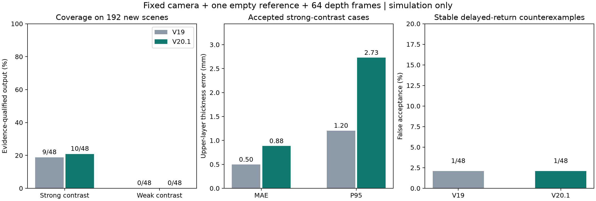

# V20.1：双层透明液体可辨识覆盖率优化报告

## 结论

**8位输入下，尚未证明稳定提高覆盖率，不建议替换 V19 主链路。** 最终只增加1个场景，配对检验 p=1.0；新增场景厚度误差约4.15 mm。V20.1 保留为实验分支。

固定顶部相机、一次空容器标定、同一份320×180 RGB与64帧深度输入。在两批全新仿真测试中，强折射率差双层液体的证据合格输出率由 **18.75%（9/48）**变为 **20.83%（10/48）**，变化 **+2.08 个百分点**。

V20.1 接受样本的上层液体厚度 MAE 为 **0.88 mm**，P95 为 **2.73 mm**。稳定延迟伪回波误接受为 **1/48**，V19 为 **1/48**。弱折射率差组输出 **0/48**。

这是仿真下的条件性证据覆盖率。不能解读为实机工业精度、所有液体场景的总体精度，或液体身份已被物理验证。

## 1. 最终独立测试

| 指标 | V19 完整折射检查 | V20.1 完整实验流程 |
|---|---:|---:|
| 强折射率差：可输出场景 | 9/48（18.75%） | 10/48（20.83%） |
| 接受样本：上层厚度 MAE | 0.50 mm | 0.88 mm |
| 接受样本：厚度 P95 | 1.20 mm | 2.73 mm |
| 接受样本：最大厚度误差 | 1.41 mm | 4.15 mm |
| 两界面误差均≤5 mm／全部强对比场景 | 18.75% | 20.83% |
| 弱折射率差：可输出场景 | 0/48 | 0/48 |
| 单液体：内部界面误报 | 0/48 | 0/48 |
| 折射率相同：内部界面输出 | 0/48 | 0/48 |
| 稳定延迟伪回波：误接受 | 1/48 | 1/48 |

误差仅统计接受样本，拒绝样本不算零误差。厚度是上层液体垂直厚度；“两界面”是自由液面与内部液液界面，5 mm 指标的分母包括拒绝样本。它与 V12 逐像素相机轴向深度的 max(5 mm,2%) 容差不同。

### 跨批次表现

| 最终批次 | V19 强对比输出 | V20.1 强对比输出 | V20.1 接受样本厚度 MAE |
|---|---:|---:|---:|
| heldoutC | 5/24 | 5/24 | 0.64 mm |
| heldoutD | 4/24 | 5/24 | 1.13 mm |

同一批场景配对比较：V20.1 新增接受 1 个、失去 0 个，共同接受 9 个。共同接受样本的厚度 MAE：V19 0.50 mm，V20.1 0.52 mm。总体 MAE 的接受集合不同，不能单凭它判断所有场景的精度变好。

V20.1 强对比覆盖率的 Wilson 95% 区间为 [11.73%,34.26%]；配对覆盖变化的精确 McNemar p=1。这只反映本仿真分布的有限样本不确定性，不能外推成工业合格率，也不是单次厚度置信区间。

### 误接受是否被掩盖

在相同的48个伪回波反例上，V20.1 **新增误接受 0 个，保留基线误接受 1 个，消除基线误接受 0 个**。逐项编号见 V20-summary.json 的 false_acceptance_changes。有限测试中零次误接受也不代表真实风险为零。

输出来源统计：{"v20_multiscale": 9, "v19_fallback": 1}。回退分支是冻结的 **V19 折射估计**，不是 SeeGroup，也没有重新训练 V17 单液体模型。

## 2. 最终方法

### 空间独立的连续帧处理

新分支中，每个稳定像素只保留一个汇总深度，使用有效帧数、空容器噪声和帧间变化筛选。顶面观测用于估计剩余空间噪声，保留至少0.3 mm的噪声尺度。重复帧不会增加独立空间支持点；内部回波至少8个空间点、覆盖4个分区。底面最多使用20000个空间像素。

V19 回退保留原有跨帧处理与支持计数，不能宣称整个组合流程已消除重复帧相关性；这也是仍需审视的置信度局限。

低噪声下，原来的截断优化代价容易形成平坦区域；改用平滑稳健代价拟合底面折射率，解决这类优化停滞。

### 连续亚像素图像证据

对 RGB 使用分段 sRGB 线性化和色度特征，以折射模型计算对应坐标，再用连续三次样条采样空容器参考。小于1/32像素的位移仍能反映在代价中。每次最多12000个图像点；色度纹理不足时不虚构图像证据。

参考 [SciPy 官方样条插值文档](https://docs.scipy.org/doc/scipy/reference/generated/scipy.ndimage.map_coordinates.html) 和 [OpenCV 官方插值表说明](https://docs.opencv.org/4.13.0/da/d54/group__imgproc__transform.html)。本项目性能结论来自实验，不来自库文档。

### 多尺度一致性与旧方法回退

- 图像平滑尺度为0.6、1.0、1.4像素，三次都需通过各自证据检查。
- 三个尺度的候选厚度范围取**并集**，宽度仍须≤10 mm；三个点估计跨度须≤3 mm。不会通过取交集制造虚假的确定性。
- 三个尺度合格时采用其中位厚度。新旧方法都接受、但厚度相差>3 mm时拒绝输出。
- 新分支不合格时，允许冻结 V19 完整证据分支回退；V20 的采集稳定性检查必须通过。参考曝光检查仍执行。
- 不把“旧方法接受”视为物理身份保证。回退也会继承旧分支的不足，已单独统计。
- 图像权重1,000,000、代价窗口6、候选折射率差下界>0.02等是开发选定的启发式规则，不是可迁移概率置信度。

## 3. 哪些尝试失败，哪些被保留

V19 的 validationB/C 在本轮作为开发数据。初版 V20 在旧 C 开发数据上从5/24增至11/24，但两批新场景 A/B 合计仅从13/48增至14/48，且出现新的伪回波误接受。**初版不能作为稳定改善的结论，未选为本轮实验入口。**

随后 A/B 转为修订开发数据，增加多尺度一致性与 V19 回退。开发回放达到18/48，对照13/48；两者均有1/48伪回波误接受。新规则没有把全部既有问题消除。因此重新冻结后，用 C/D 做最终独立验证，最终成绩仅见第1节。

### 开发 C 的坐标精度消融

| 条件 | 强对比输出／24 | 接受样本厚度 MAE | 伪回波误接受／24 |
|---|---:|---:|---:|
| V20 空间汇总＋原V19图像检查 | 4 | 1.02 mm | 0 |
| 同一V20图像设置，仅坐标量化到1/32像素 | 8 | 1.24 mm | 2 |
| V20 连续坐标 | 11 | 0.98 mm | 0 |

这说明亚像素坐标精度确实有影响，但完整提升不能全归于一个改动；色度处理、样本数和证据权重也发生了变化。

### 原始RGB位深补测（开发数据，不作为最终独立成绩）

仿真PNG本身为16位，原评测读取成8位。保留文件实际位深重新回放 A/B：V20.1 强差输出17/48，对照8位开发回放18/48；原生位深下 V19 为13/48，两者均有1/48伪回波误接受。因此，单独保留位深没有带来覆盖突破，没有将其并入本轮8位默认试验流程。实机可用位深必须来自设备与文件真实输出，不能把8位图像转换存成16位当作新增信息。

## 4. 数据与输入边界

- 最终源码冻结提交：8a41284b3d5f29f1c30046984206f80c91a32875；种子207001、208001，伪回波种子807001、808001。最终192个液体条件来自48个独立基础配置，每配置含单液体、相同折射率、弱差、强差四种条件。
- 强差范围0.085–0.20，弱差0.005–0.025；上下层都透明且近水平。本轮不代表三层以上或散射明显的多液体。
- 四种条件共享几何、底纹、光照、噪声和掉点参数；空容器深度在配对组内相同，RGB有独立渲染的极小差异（8位归一化RMSE均值约0.000019），不宣称像素完全相同；新生成器修复了 V19 四组随机数消耗不一致的问题。
- 固定相机、一次空容器 RGB/深度标定、运行时一张RGB与64帧同位姿深度、SDK内参／深度单位／配准信息。没有新增视角、分辨率或液体真值先验。
- 相机到液面距离、底面、支持区域从观测估计。不输入真实折射率、液体类型、层厚、层数或真实掩码。真值只供模拟器和推理后的评测使用。
- Cycles GPU、2048固定采样、无去噪／自适应采样；空容器参考驱动曝光调整。深度仍是无色散、共轴、单路径 ToF 类代理，带噪声、掉点、1 mm量化和固定像素偏差，尚未校准到真实RGB-D设备。
- 64帧采集时间另计；计算时间不是完整采集到输出的时延。算法使用CPU，不加载新的学习权重。

## 5. 剩余不足

弱界面回波少，常不足8个分散支持点；0.02折射率差门槛也排除部分真实弱界面。本轮没有解决这个问题，不能据此宣称物理上不可观测。

最终48个强差场景均产生了候选，候选厚度误差均≤5 mm；其中38个因证据不够而拒绝，拒绝组候选 MAE 约1.57 mm。这是事后使用真值的诊断，不能把它们改计为可信输出。当前主要瓶颈是排除伪回波／单液体解释，而不是再增加候选数量。

强差组拒绝原因：
- no_consistent_refraction_evidence：38个。

| 底面条件 | V20.1 强差输出 | 接受样本厚度 MAE |
|---|---:|---:|
| 均匀底面 | 2/24 | 0.54 mm |
| 有色棋盘底纹 | 8/24 | 0.97 mm |

底纹分组仅供评价；推理从参考图计算纹理，不读取分组标签。代码中的RGB分支主要做折射坐标重映射，还没有完整拟合反射、高光和照明变化。各项模型误差的贡献尚未分离；更高位深本身不能替代成像模型校验。参考不一致、相机漂移、一般多路径和折射率／层厚替代解仍有风险；多尺度检查不等于完整的光学可辨识性证明。

## 6. 交付

实验入口：scripts/infer_refraction_consensus_v20.py；运行说明见 V20-usage.md。V20 原型入口保留作复现对照，不作为本轮推荐的默认流程。V17 单液体代码和权重、原 V19 文件保持不变；权重与原始交付索引已核对。

44项相关测试通过，公开推理入口另做实测数据文件冒烟验证。交付包含代码、逐场景结果、失败迭代、冻结配置、输入哈希、日志和代表样本；全部深度序列仍在服务器。

是否继续深入，应同时看第1节的覆盖变化和新增误接受，而不能只追求输出数量。下一阶段仍需处理弱界面稀疏回波、参考一致性及实机传感器模型验证。
