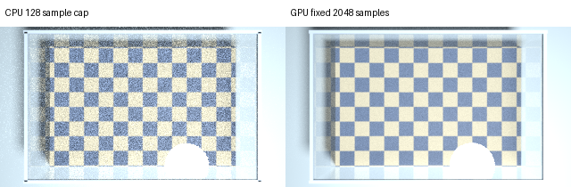

# V18：顶部双透明液体的 SeeGroup 链路筛查

## 结论与投入建议

**现有 SeeGroup 相关链路不能直接承担顶部双透明液体的界面定位和层厚测量。保留其多层表示作为基线，暂不继续长时间训练现有 V9.1 链路；优先验证真实分层数据、折射约束和可测性判断。**

本轮实际运行了官方 SeeGroup 权重、项目 V9.1 多层分支及深度输入置零消融，补做原版去重、传感器尺度锚定、真实顶底面理想校准，并用更高采样图像复测。未训练权重，未修改 V17 单液体链路。其他论文只完成适配性调研，尚未运行其模型。

这是受控仿真筛查。它支持“现成链路尚不可用”的判断，不能证明 SeeGroup 经专门训练后无效，也不能作为真实油水传感器精度或工业验收结论。

## 1. 场景与输入边界

相机位于开口容器正上方，中心视线穿过空气、上层液体、下层液体、底面。侧边干扰不作为多液体标签；评价区域位于中心，避开边缘。

- 16 组配对配置：上层厚度 2 / 10 / 30 / 50 mm × 相机到顶面距离 0.3 / 0.6 m × 均匀 / 棋盘底纹。
- 每组四种条件，共 64 张图。**不是 64 个独立场景**，单液体条件中部分物理配置重复。
- 条件：单液体；等折射率内部界面对照（1.333 / 1.333）；弱差异（1.343 / 1.333）；较强差异（1.47 / 1.333）。
- 总液深 100 mm；平整、无吸收、无色散的理想介质；共享内部界面只建一次，使用相对折射率 n下/n上；不含玻璃容器壳。
- RGB 为 320×180 的 Cycles 路径追踪图。首轮 CPU 最多 128 采样；最终复测 GPU 固定 2048 采样、关闭自适应采样和降噪。后端也发生变化，因此这是质量稳健性复测，不能视为仅改变采样数的严格收敛实验。
- 深度输入为带丢点和噪声的简化同轴单路径 ToF 类代理，含顶面、内部界面和底面回波抽样及光程影响。它**没有针对具体 RGB-D 相机校准**，没有真实多径波形、波长响应或散射模型；不能代表双目相机。

推理可用：RGB、代理原始深度及原链路编码。材料折射率、真实液深、层数、顶面距离、真实掩码只用于生成与评分。单独标为“理想校准”的诊断使用了真值，禁止作为部署结果。

## 2. 实测链路与公平性处理

| 链路 | 实际处理 | 解释边界 |
|---|---|---|
| 官方原版 | 官方权重严格加载，RGB 输入，原生四分量和有效性输出 | 原输出具有尺度/平移歧义，不能直接视为米 |
| 原版 + 深度尺度锚定 | 全图有效原始深度中位数 / 最近有效预测中位数，得到单一比例 | 无真值输入，但错误底面回波会污染锚点，比例也不能解决所有平移误差 |
| 原版 + 去重 | 原坐标中过滤 ≤0.02，按最后保留分量间隔 >0.02 去重，再尺度锚定 | 0.02 是模型坐标阈值，不是 20 mm；本批结果与不去重相同 |
| 原版 + 理想顶底校准 | 每帧在评价区域取最近/最远预测的中位数，对齐真实顶面和底面，内部深度不参加校准 | 同时使用真实区域和顶底距离，仅诊断相对层结构，非可部署精度，也非所有校准方法的最优上界 |
| 项目 V9.1 | 现有 RGB-D 四层模型，存在概率 ≥0.5 保留候选 | 项目改造分支，与官方模型不是同一个网络 |
| V9.1 深度置零 | 保留 RGB，原始深度全零 | 输入消融；分布变化不能等同于完整 RGB 模型的能力 |

官方方法使用尺度不变训练，论文主要展示相对深度指标；论文结果不能换算成我们的毫米精度。[SeeGroup 原论文](https://arxiv.org/html/2605.28735v1)

## 3. 指标定义

每张图在中心评价区域均匀取 512 个像素。以单液体的顶面、底面，或双液体的顶面、内部界面、底面为几何真值，执行严格一对一匹配；同一个预测不能同时命中两个真值。

主表使用**固定 5 mm 相机轴向深度容差**，不是“液体层厚误差 5 mm”：

- 内部命中率：匹配中内部界面被命中的像素占比。
- 双界面同时命中率：顶面和内部界面都被不同预测命中的像素占比；**仍未验证语义身份，也允许额外预测**。
- 完整集合：所有真值均命中且无多余预测，另存原始结果。
- 两最近候选层厚 MAE：取最近两候选相减。它是明确的简单启发式，不是专门训练的双液体测量器。
- 真值选对候选诊断：用真值选取顶面/内部界面的两个不同候选，最小化深度定位误差，再计算厚度误差。不能用于部署。

另外保留 max(5 mm, 2%) 容差的结果。2 mm 薄层与 5 mm 单界面容差不匹配，必须结合厚度误差和错层率，不能单凭命中率宣称薄层测准。

## 4. 最终高采样复测结果

每种液体条件 16 张图、8192 个抽样像素。下表为像素统计，不能将其视为 8192 次独立实验。

| 方法 | 弱差异：内部命中 | 较强差异：内部命中 | 弱差异：双界面同时命中 | 较强差异：双界面同时命中 |
|---|---:|---:|---:|---:|
| 原版 + 深度尺度锚定及去重 | 0.012% | 0.012% | 0.000% | 0.000% |
| 项目 V9.1 | 1.990% | 2.112% | 0.024% | 0.024% |
| V9.1 深度置零 | 0.000% | 0.000% | 0.000% | 0.000% |
| **原版 + 真值顶底校准（仅诊断）** | **22.656%** | **25.549%** | **6.458%** | **10.803%** |

原版尺度锚定失败，只能说明这套简单接入方式不好，不能单凭该行否定原模型。理想校准后的结果进一步表明：消除这类尺度问题以后，仍没有稳定恢复内部层结构。

### 厚度结果

| 方法 | 弱差异层厚 MAE | 较强差异层厚 MAE | 可产生两候选的像素覆盖 |
|---|---:|---:|---:|
| 原版尺度锚定，两最近候选 | 31.11 mm | 48.98 mm | 100% / 100% |
| V9.1，两最近候选 | 19.17 mm | 19.25 mm | 65.81% / 68.16% |
| 原版理想校准 + 真值选两候选，仅诊断 | 23.59 mm | 22.92 mm | 100% / 100% |

V9.1 覆盖不足，且与原版覆盖不同，不能仅比较 MAE 大小排名。深度置零后没有两候选可计算层厚，其结果为缺失，**不是误差为零**。即便理想校准及真值辅助选层，厚度误差仍为约 23 mm，尚不适合本批 2–50 mm 厚度范围。

采用原有 max(5 mm, 2%) 容差，V9.1 双界面同时命中率也只有 0.037% / 0.049%；原版理想校准为 23.12% / 25.92%，仍远未稳定。

### 无信号对照与渲染质量

等折射率、无吸收的理想界面在光学上不提供界面位置线索。原版理想校准后，等折射率组的内部命中率仍达到 **23.08%**，与弱差异组 **22.66%** 接近。这说明部分几何“命中”可能来自分量位置和容差偶合，不能当作识别到真实液体界面的证据。

首轮低采样时，原版理想校准内部命中率为 24.96% / 24.29%，高采样为 22.66% / 25.55%；核心结论未改善。V9.1 从 0.48% / 1.64% 变为 1.99% / 2.11%，仍很低。

等折射率与单液体的中心 RGB 差异（8 bit 平均绝对差）从 19.83 降至 6.17，结合图像检查表明噪声明显降低，但没有证明完全收敛。残余渲染噪声、理想化材质及训练域差异仍限制结论。

### 计算代价

RTX 5090，批量 1 的本轮前向耗时中位数：原版约 **110.50 ms**，V9.1 约 **4.05 ms**。原版含内部缩放；不含文件读写、主机传输、指标计算或完整后处理。不是端到端延迟，也未另做专门的重复测速。

## 5. 不足原因：哪些已经有证据

1. **原有多层数据定义不覆盖真正双液体。** 前一阶段代码审计发现，多层标签主要对应容器、单液面和底面，不能证明网络受过内部液液界面监督。
2. **原版层表示与实际液体身份之间缺少桥接。** 本批原版平均保留四个分量，单液体也如此；几何集合无法直接告诉我们哪层是空气—液体、哪层是液体—液体。
3. **绝对尺度接入不可靠。** 原始深度可能测到光程相关的底面，简单比例会把整组层位置拉错；顶底理想校准有所改善，但不能解决结构缺失。
4. **弱内部界面的证据不足。** 等折射率对照没有物理位置信号，不能要求模型稳定猜出内部真值。n=1.47/1.333 的法向界面反射功率约 0.239%，弱差异条件更小；真实可测性还依赖照明、视角、纹理和传感器。
5. **V9.1 强依赖现有深度输入分布。** 深度置零后分量基本消失；当前代理上的失败可能包含传感器域偏移，不能将其全部归因于多层网络结构。
6. **现有结果还不是液深测量。** 几何匹配允许额外分量，未建立可部署的双界面身份、可测性拒绝、空间分散支撑和可靠层厚估计。

这些证据支持暂停原链路盲目长训，但尚不能把失败全部归为物理极限。

## 6. 值得借鉴的其他工作

| 工作 | 有价值的思路 | 与顶部双液体的适配 |
|---|---|---|
| [Opti-NeuS，CVPR 2026](https://openaccess.thecvf.com/content/CVPR2026/html/Yang_Opti-NeuS_Neural_Reconstruction_for_Dual-Layered_Transparent_and_Opaque_Objects_CVPR_2026_paper.html) | 折射率估计、折射光路追踪、外内几何分阶段重建 | 优先借鉴物理建模；原任务是多视图透明/不透明嵌套物体，未证实适用于油水，不能直接替换单帧链路 |
| [Through the Looking Glass，CVPR 2020](https://arxiv.org/abs/2004.10904) | 把反射、折射渲染与几何估计联合起来 | 适合借鉴可微成像约束；原方法需要少量多视图及已知环境光照图，这些必须通过采集获得 |
| [Laser triangulation for liquid film thickness measurements through multiple interfaces](https://opg.optica.org/ao/abstract.cfm?uri=ao-45-20-4916) | 用折射模型解释多界面测厚误差，并做实测验证 | 与液膜厚度更直接相关；需要激光三角测量装置及标定，是增加观测能力的备选，非纯软件替换 |

上述工作的任务与输入各不相同，本轮没有按论文名声排名，也没有将其论文精度套用到我们的场景。

## 7. 下一轮建议：先做小规模、可判输赢的验证

**优先方向：双界面几何 + 折射成像一致性 + 可测性拒绝。** SeeGroup 仅保留作初始化/对照；顶部平整分层可先用少量平面参数描述，减少自由度，但平整约束本身仍不能辨认液面身份。

1. 建立真实双液体训练/验证数据，按容器、材质、照明及厚度配置拆分；当前 64 张仅作诊断，不能训练后再次当独立测试。
2. 对照两个模型：SeeGroup 的有限微调；直接预测顶面/内部界面、存在性与不确定性的轻量模型。两者使用相同可获得输入、同样新数据预算。
3. 在第二个模型中加入折射成像一致性，检验其是否优于纯监督；未知折射率作为待估变量并输出歧义，不能输入测试真值。
4. 可获得参数的来源必须明确：相机内参来自标定/SDK；固定容器底面来自空容器标定；底纹参考来自实际空容器图。**仅有参考底纹并不保证未知折射率与多层厚度可同时辨识**。
5. 若单张顶部 RGB-D 仍存在不可辨识组合，比较有限的多视角或受控照明采集；把采集步骤计入完整链路。相机不能移动、不能增加观测时，应允许报告“界面不可测”，不能靠默认厚度补答案。

进入长时间优化的条件应提前固定：在独立可观测双液体上，双界面定位和层厚误差显著优于当前基线；同时单液体/等折射率对照中的虚假分层和错误高置信度受控。具体毫米验收线须按实际最小层厚及业务容差设定，本轮不虚构工业标准。

## 8. 复现与交付

- 项目分支：codex/v18-stratified-liquid-diagnosis；V17 基线 c8819910f9061319ebfd8e9c037f59d2f71f64fb。
- 官方源码：765cbe45f218553a146f8f887c09310c1e969998e；版本、权重路径及 SHA256 见 source-provenance.json / checkpoint-hashes.json。
- 服务器结果：/root/autodl-tmp/liquid-depth-artifacts/diagnostics/stratified-seegroup-v18；最终复测在 fixed2048/。
- 最终数据：/root/autodl-tmp/liquid-depth-data/synthetic/stratified-v18-cycles-fixed2048。
- 新增生成、评估、诊断、汇总脚本；一对一匹配及本轮后处理测试共 **12 项通过**。V18 前一阶段完整回归为 249 项通过；本轮未声称重跑该整套测试。
- 本轮没有更改或训练 V17 权重，没有把真值标定引入生产推理，也没有删除既有实验依据。
