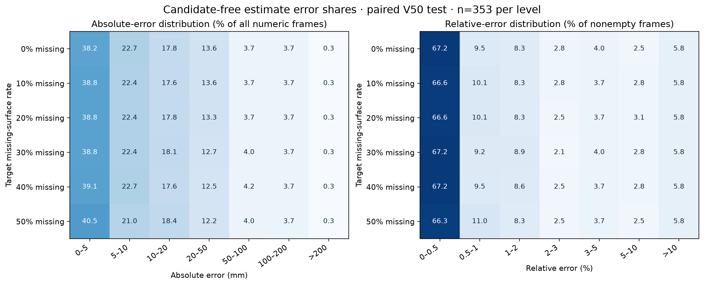
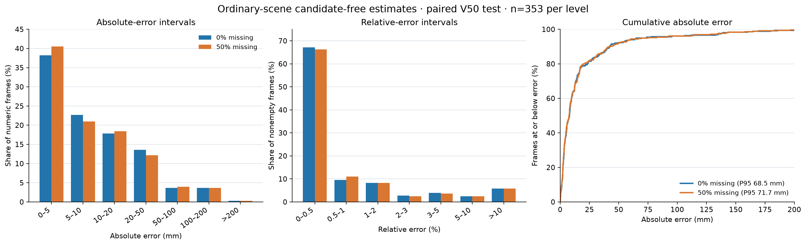

# 普通场景：放开液面候选后的逐帧估计与大误差归因（2026-10-13）

## 结论

在原有 V50 独立确认仿真集上，诊断链路不使用学习液面掩码、候选概率阈值、最少液面点数门槛、强制归零或液深裁剪；只保留已由空槽图像建立的容器几何，取容器内部原始深度点的米制液深中位数。公平配对的每档 353 帧在 0%–50% 人为液面深度缺失下均得到数值。但“有数值”不等于“准确”：0% 缺失档的全帧容差通过率为 86.7%，MAE 18.3 mm、P95 68.5 mm；50% 档分别为 87.3%、18.2 mm、71.7 mm。不能将该诊断链路直接替换为工业默认输出。

相对容器底面的实际液深是唯一计分量。容差为 `max(5 mm, 实际液深×2%)`；空槽用 5 mm 判定。数值覆盖率是得到有限液深值的帧比例；全帧通过率的分母包含未输出帧。下面所有 MAE、P95 均只统计已有数值的帧，因此须与覆盖率一起看。

## 实验边界与口径

- 数据：既有 V50 独立确认集，99 个安装场景 × 4 次采样，共尝试 396 个原生帧；不是新采集的实物相机数据。
- 其中 8 帧（两个安装场景各 4 次）在空槽几何建立阶段失败，原因是 `selected_points_outside_image`。这 8 帧并非液面候选门控拒绝；没有可信底面坐标系，不能声称得到可部署的米制液深。
- 其余 388 帧全部得到原生帧数值。控制液面真实缺失率到 0%–50% 的公平配对组为每档 353 帧；另有 35 个原生帧的液面像素本来已缺失超过 0.5%，不适合归入 0% 档，但单独审计，不能隐去。
- 估计时仅使用空槽拟合几何、容器范围、当前原始深度；仿真真值像素和真值相机几何只用于离线反事实归因，不进入估计。所谓“放开候选”不等于放开物理容器范围；若连容器范围也去掉，底面/壁面/背景将混入，液深定义将失效。
- 普通链路的应用边界仍是正常漫反射、液面近似单层可见、空槽几何可建立的容器。透明/半透明、多层反射、漂浮物和强眩光不能从本结果推断可用。

## 公平配对结果：每档 353 帧

第一张图覆盖全部六档液面深度缺失率。格内数字是该档帧数占比（%）：绝对误差以全部 353 个数值帧为分母，相对误差仅以非空槽帧为分母。各档分布接近，说明该批样本的大误差尾部没有随人为缺失率增加而明显变化。

第二张图重点对照 0% 和 50% 两端档位，并展示绝对误差累积分布。累积图横轴只显示到 200 mm，但每档还有 1 帧超过 200 mm。

| 人为液面缺失率 | 原基线数值覆盖率 | 原基线全帧通过率 | 原基线条件 MAE | 无候选数值覆盖率 | 无候选全帧通过率 | 无候选 MAE | 无候选 P95 |
|---:|---:|---:|---:|---:|---:|---:|---:|
| 0% | 64.9% | 62.9% | 13.4 mm | 100% | 86.7% | 18.3 mm | 68.5 mm |
| 10% | 69.7% | 67.4% | 13.4 mm | 100% | 86.7% | 18.5 mm | 68.8 mm |
| 20% | 69.7% | 68.6% | 12.4 mm | 100% | 86.7% | 18.5 mm | 70.6 mm |
| 30% | 69.7% | 66.9% | 18.5 mm | 100% | 87.0% | 18.5 mm | 72.4 mm |
| 40% | 69.4% | 66.6% | 15.9 mm | 100% | 87.0% | 18.3 mm | 68.2 mm |
| 50% | 70.5% | 68.0% | 17.2 mm | 100% | 87.3% | 18.2 mm | 71.7 mm |

对照上一版已优化的 V49 候选门控链路，0% 档数值覆盖率/全帧通过率/条件 MAE 为 76.2%/72.2%/12.3 mm；50% 档为 73.4%/70.8%/16.7 mm。无候选估计把原本拒绝的一部分帧救回，同时使已输出帧的平均误差和尾部风险增大。原基线已通过的帧在该配对集上没有转为不通过，但不能据此推断其他场景不会退化。

### 全量原生帧审计

在 388 个成功建模的原生帧中，无候选链路数值覆盖 388/388，容差通过 312/388（80.4%），MAE 25.5 mm、P95 138.5 mm。35 个未纳入公平配对组的原生高缺失帧虽然也全部得到数值，却仅 6/35（17.1%）通过，MAE 98.8 mm、P95 270.7 mm。按全部 396 个尝试帧计，数值覆盖是 388/396（98.0%），全帧通过 312/396（78.8%）；8 个几何初始化失败帧必须按未输出计。这更接近“尝试所有帧”的完整审计口径，不能只报配对组的 100%。

## 误差分布与薄弱区间

公平配对组 0% 档的绝对误差占比：0–5 mm 为 38.2%，5–10 mm 为 22.7%，10–20 mm 为 17.8%，20–50 mm 为 13.6%，50–100 mm 为 3.7%，100–200 mm 为 3.7%，超过 200 mm 为 0.3%。50% 档分别为 40.5%、21.0%、18.4%、12.2%、4.0%、3.7%、0.3%。0% 档非空槽 AbsRel 为 2.26%，相对误差超过 10% 的帧占 5.8%；50% 档 AbsRel 为 2.25%，超过 10% 仍为 5.8%。

按传感器看，0%/50% 两档的结构光通过率都只有 80.6%，MAE 30.1/29.5 mm，P95 136.9/132.1 mm；双目为 87.0%/88.7%，MAE 20.6/21.0 mm，P95 98.6/98.1 mm；ToF 为 91.5%/91.5%，MAE 均约 6.4 mm，P95 16.6/16.4 mm。这些是**当前仿真参数**的结果，不是任意同类商用相机的实测性能。

液深 0.01–0.1 m 的 0% 档仅 57.1% 通过，0.1–1 m 为 70.4%；空槽为 74.1%。1–2 m、2–3 m、3–4 m、4–5 m 的通过率分别为 77.4%、84.4%、88.9%、88.9%；5–9 m 各档在这个样本集上达到 100%。深液位通常使相机到液面的工作距离变短，故不能仅以“液深越大越容易”解释；应同时按相机到液面的距离复核。远距离浅液位的相对容差尤其紧，几毫米到几十毫米偏差就会超标。

## 大误差归因

0% 档 353 帧中，绝对误差 >20、>50、>100、>200 mm 分别有 75、27、14、1 帧；50% 档为 71、28、14、1 帧。0% 档的 27 个 >50 mm 案例中，结构光 16 个、双目 11 个，ToF 0 个；这些帧容器内所选点为真实液面像素的平均比例约 99.94%，最低仍为 99.2%。其中 22/27 即使用“真液面像素 + 真相机几何”离线重算，误差仍超过 50 mm；没有案例的选点混入或几何偏移单独达到 50 mm。此证据指向当前仿真中传感器返回值的偏差/噪声，而非液面候选漏选是主要大误差源。

按更严格的 `max(50 mm, 实际液深×5%)` 定义，0% 档严重误差 7 帧，其中 6 帧在真液面像素、真几何条件下仍已严重失准；50% 档严重误差 8 帧，其中 7 帧如此。最差实例：结构光 case 50/rep 1，真液深 3.287 m、估计 3.014 m，偏低 272.7 mm；真液面+真几何的离线反事实仍偏低 260.9 mm。双目 case 29/rep 3，真液深 1.427 m、估计 1.228 m，偏低 199.3 mm；真值条件仍偏低 189.2 mm。这里不能继续靠扩大掩码、复杂平面拟合或减小拒绝阈值消除误差。

上述实例中，工作距离约 6–8 m、真视差只有约 1.8–2.2 像素；约 0.03–0.04 像素的系统性视差偏差经远距离三角测量可放大为明显深度误差。结构光的相位/匹配偏差、空间相关噪声、视差量化及错误回波都可能贡献；当前反事实定位到“返回深度层”，但尚未以逐因素消融证明某一因素的独立贡献。试验性的“丢弃两端 10% 视差后求均值”反而显著变差，因此不采用。

另有 8 个几何建模失败帧：两个容器的轮廓选点落出图像。离线借用真几何可算出其中一组约 -55 至 -59 mm、另一组约 -0.9 至 -1.4 mm 的误差，但这**不是实际链路输出**。应单独修复空槽建模或标定反馈，不能将真几何反事实算成覆盖。

## 处理建议与交付状态

1. 保留当前生产门控；新增无候选估计仅作诊断或明确标记为低置信度的候选值，不作为默认工业读数。透明/半透明及多层场景更不能继承普通漫反射实验的放宽策略。
2. 针对双目/结构光，在不同相机—液面距离下标定亚像素视差偏置、结构光相位偏置和底部回波；用独立实测靶面而非仅用当前仿真值校准。
3. 对远距离浅液位做 2–4 帧联合估计并验证误差相关性。若偏差在多帧间同号且稳定，时间平均不能修正，必须先校偏；需要拆分“随机噪声降低”和“系统偏差校正”两项收益。
4. 对 35 个自然高缺失帧与 8 个几何失败帧分别建专项集；前者要验证真正可观测的表面证据，后者需要改进空槽标注和几何初始化。建立不能输出数值时的明确原因码。
5. 后续仿真做逐因素消融：视差量化、相关噪声、错误回波、空槽底部噪声各自开关；再用真实相机核验。当前结果只证明放开候选不足以解决传感器级大偏差，不证明某一噪声项是唯一根因。

复现脚本：`scripts/evaluate_unrestricted_surface_v51.py`。主要逐帧记录与配对汇总：`/root/autodl-tmp/liquid-depth-artifacts/evaluation/unrestricted-v51b-v50-attribution-20261013/`。另有探索性视差估计：`/root/autodl-tmp/liquid-depth-artifacts/evaluation/unrestricted-v51c-v50-trimmed-20261013/`，该方法未采纳。
